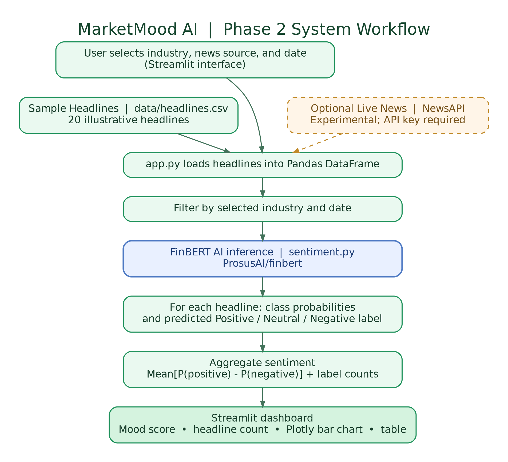

# MarketMood AI

**Financial News Sentiment & Market Mood Dashboard**  
CECS 451 — Term Project, Phase 2

MarketMood AI is a Python/Streamlit prototype that uses **FinBERT** to analyze short financial headlines and describe their **news sentiment** as positive, negative, or neutral. Users can choose the **Energy** or **Semiconductors** industry, select a date, and review an overall mood score, a sentiment breakdown chart, and the individual headline classifications.

> **Scope:** This is a noncommercial academic prototype. News sentiment is **not** a stock-price prediction, trading signal, or investment recommendation.

## Current features

- **Sample Headlines** mode works from `data/headlines.csv` (20 illustrative headlines: 10 Energy and 10 Semiconductors).
- Filter sample headlines by **industry** and **date**.
- Run each selected headline through `ProsusAI/finbert` using Hugging Face Transformers.
- Show positive, negative, and neutral classifications, a **Market Mood Score**, the number of headlines analyzed, and a Plotly bar chart.
- Display individual headline predictions in a Streamlit table.
- **Live News** mode is included as an *experimental* NewsAPI connection. Its successful retrieval is **not yet verified** and it is **not needed** for the sample-data demo.

## Project files

| File | What it does |
| --- | --- |
| `app.py` | Streamlit interface, industry/source/date selection, CSV loading, optional NewsAPI request, score aggregation, and charts. |
| `sentiment.py` | Loads the `ProsusAI/finbert` model and calculates sentiment probabilities and per-headline mood scores. |
| `data/headlines.csv` | Illustrative headline text, industry labels, and dates for reproducible demonstrations. |
| `requirements.txt` | Python dependencies. |
| `docs/workflow_diagram.png` | Architecture/workflow diagram for the implemented prototype. |
| `docs/workflow.mmd` | Editable Mermaid source for the diagram. |

## Requirements

- Python and pip (the sample-data dashboard was successfully launched in **Python 3.13 on Windows** during team testing).
- Internet access on the first run so Transformers can download the pretrained FinBERT model.
- Project dependencies listed in `requirements.txt`: `streamlit`, `transformers`, `torch`, `pandas`, `plotly`, and `requests`.

### Install and run on Windows (PowerShell)

Run these commands **in the repository's root folder** (the folder containing `app.py`):

```powershell
py -3.13 -m venv .venv
.\.venv\Scripts\python.exe -m pip install --upgrade pip
.\.venv\Scripts\python.exe -m pip install -r requirements.txt
.\.venv\Scripts\python.exe -m streamlit run app.py
```

If you use a different installed Python version, change `-3.13` to that version. You do **not** need to activate the virtual environment with these commands.

### Install and run on macOS / Linux

```bash
python3 -m venv .venv
source .venv/bin/activate
python -m pip install --upgrade pip
python -m pip install -r requirements.txt
python -m streamlit run app.py
```

Streamlit normally opens at **http://localhost:8501**. The first inference may take longer while FinBERT is downloaded and loaded into memory.

## Reproduce a sample result

1. Open the dashboard at `http://localhost:8501`.
2. Set **Select Industry** to **Energy**.
3. Set **Choose News Source** to **Sample Headlines**.
4. Set **Select Date** to **2026-11-17**.
5. Review the Market Overview, Sentiment Breakdown, and Headline Analysis sections.

An observed team test produced:

| Item | Observed result |
| --- | --- |
| Industry/date | Energy / 2026-11-17 |
| Headlines analyzed | 2 |
| Market mood score | **-0.42** (negative) |
| `Oil company makes more money` | Neutral |
| `Oil company loses money` | Negative |

These values describe a **single preliminary run on illustrative examples**, not a measured classification-accuracy result. In particular, the neutral classification for the first headline shows that model outputs may not always agree with a person's interpretation. Predicted scores may change if model or dependency versions change.

You can also switch the industry to **Semiconductors** and choose an available date to test the other sample subset.

An observed team test produced:

| Date | Headlines analyzed | Market mood score | Label |
| --- | --- | --- | --- |
| 2026-11-17 | 2 | -0.05 | Negative |
| 2026-11-18 | 2 | -0.44 | Negative |
| 2026-11-19 | 2 | -0.36 | Negative |
| 2026-11-20 | 4 | +0.08 | Positive |

Individual headline classifications are visible in the screenshots at [`docs/screenshots/`](docs/screenshots/). Note: on 2026-11-20, all four headlines were classified neutral, yet the averaged score (+0.08) was still labeled Positive.

## How the AI and scoring work

`sentiment.py` uses the Transformers `pipeline` with `model="ProsusAI/finbert"` and returns a probability for each of the three classes: `positive`, `negative`, and `neutral`.

For each headline:

```text
Headline mood score = P(positive) - P(negative)
Predicted sentiment = class with the highest probability
```

In `app.py`, the **Market Mood Score** is the arithmetic mean of the scores for all headlines matching the selected industry and date. It ranges from -1 to +1. The dashboard calls scores **above +0.05** positive, **below -0.05** negative, and scores between those thresholds neutral. The sentiment chart counts predicted labels; it is not a historical time-series chart.

## System architecture and workflow



The implemented sample-data path is:

`Sample CSV → industry/date filtering → FinBERT → per-headline labels and probabilities → average mood score + sentiment counts → Streamlit dashboard`

The optional NewsAPI path supplies a different headline DataFrame before the same filtering and model analysis. The visual diagram's **dashed** input marks this experimental path.

The diagram's editable Mermaid source is at [`docs/workflow.mmd`](docs/workflow.mmd).

## Optional Live News / NewsAPI configuration

**No API key is required for Sample Headlines mode.** To try Live News locally:

1. Create a `.streamlit` folder in the project root if one does not exist.
2. Create `.streamlit/secrets.toml` containing:

   ```toml
   NEWS_API_KEY = "YOUR_NEWSAPI_KEY"
   ```

3. Restart Streamlit, select **Live News**, and click **Search News**.

The `app.py` function `search_news()` requests up to 20 English-language articles for the selected industry from the last seven days, then supplies their title, date, publisher, and URL to the dashboard. The current implementation expects `st.secrets["NEWS_API_KEY"]`, and an invalid/missing key or empty/limited API response can prevent Live News from loading. This path remains **unverified** in the current milestone.

**Security:** Do not commit `.streamlit/secrets.toml`, API keys, passwords, or other secrets. The repository's `.gitignore` already excludes `.streamlit/secrets.toml` and `.venv`.

**Data rights:** NewsAPI's free Developer service has restrictions on freshness and deployment; check the provider's current terms before using live news outside local development. The selected FinBERT model weights also have noncommercial licensing restrictions.

## Our technical contribution

FinBERT provides the underlying sentiment classification. The team's own work is:
- The mood-scoring formula (P(positive) - P(negative)) and the industry/date averaging logic
- The sample headline dataset (`data/headlines.csv`)
- The Streamlit dashboard: filtering, layout, styling, and the Plotly chart
- The optional NewsAPI live-news integration

## Known limitations and next steps

- The 20 CSV headlines are **illustrative**, not verified articles from real publishers; results cannot establish real-world market sentiment.
- The existing dashboard only analyzes **one selected date at a time**; it does not yet offer multi-day aggregation or saved historical trends.
- Live News retrieval through NewsAPI is **not fully verified**; the sample CSV is the reliable demonstration path.
- The current code does not deduplicate headlines or calculate classification precision, recall, or F1; those require additional data and evaluation.
- Very short or ambiguous financial headlines can be misclassified. News tone is not a stock-return forecast.
- Next steps: test the live-data error cases; add duplicate detection and better source handling; evaluate on a manually labeled dataset; improve the date-range options and user testing.

## References and technology links

- [FinBERT model card](https://huggingface.co/ProsusAI/finbert)
- [Streamlit documentation](https://docs.streamlit.io/)
- [Hugging Face Transformers documentation](https://huggingface.co/docs/transformers/)
- [NewsAPI documentation](https://newsapi.org/docs)

---

**CECS 451 project** · Phase 2 proof of concept · November 2026
